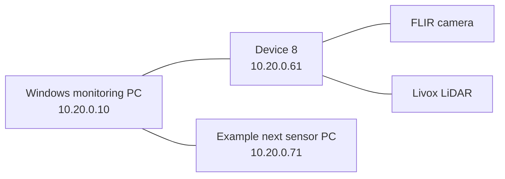
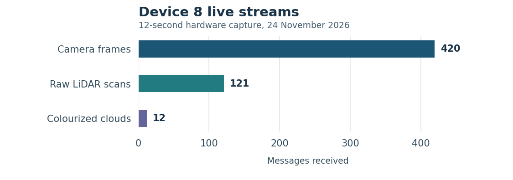

# Device 8 setup

ROCK 5C runs ROS 2 Jazzy in an Ubuntu 24.04 ARM64 container on Radxa Debian 12. See the [host and SDK details](../docs/ROCK5C_ENVIRONMENT.md) and [ROS 1 migration notes](MIGRATION.md).

## Connect one monitoring PC to multiple sensors



| Computer | Ethernet IP | ROSBridge | DDS domain |
| --- | --- | --- | --- |
| Windows monitoring PC | `10.20.0.10/24` | Connects to each sensor | Set per app profile |
| Device 8 | `10.20.0.61/24` | `ws://10.20.0.61:9090` | `0` |
| Example next sensor PC | `10.20.0.71/24` | `ws://10.20.0.71:9090` | `1` |

Keep the monitoring PC's IP. Give each new sensor PC an unused IP and a separate DDS domain when rigs share the default topic names. Set matching values in [the sensor runtime](deploy/runtime.env) and [the Windows profile](deploy/device_8.env.example). Rigs can reuse camera and LiDAR IPs on isolated networks. Devices sharing a VLAN need unique addresses.

| Device 8 hardware | Address or identity |
| --- | --- |
| Sensor Ethernet interface | `end1` |
| FLIR Blackfly S | `10.20.0.22`, serial `25120439` |
| Livox-facing address on the sensor PC | `192.168.1.50/24` |
| Livox Avia | `192.168.1.125`, broadcast code `3JEDN920015M711` |

Cyclone DDS advertises the address in the runtime's `SENSOR_IP` setting. Use the sensor's monitoring-network IP there. The network script uses Device 8's addresses. Review the plan and adapt the interface and IPs before using it on another rig.

```bash
./ros2/tools/configure_network.sh
sudo bash ros2/tools/configure_network.sh --apply
```

## Build and install

| Prerequisite | Requirement |
| --- | --- |
| Host | Debian 12 ARM64, `docker.io`, Docker group access |
| Camera SDK | Teledyne Spinnaker `4.4.0.246` for Ubuntu 24.04 Noble ARM64 |
| SDK archive | `spinnaker-4.4.0.246-noble-arm64-pkg.tar.gz` from Teledyne |

Archive SHA-256 `9c4aef63cb070a4734e7e93051898b70aaeac17c13b86ef7cbee8c787554e261`. The build uses pinned sources and installs the SDK components required for GigE acquisition.

```bash
cd /home/rock/Sensor_Computer
mkdir -p ros2/vendor/sdk
tar -xzf ~/Downloads/spinnaker-4.4.0.246-noble-arm64-pkg.tar.gz -C ros2/vendor/sdk
./ros2/tools/build.sh
./ros2/tools/verify.sh
sg docker -c 'python3 ros2/tools/container_recovery_test.py'
```

Build in the target workspace. The verification scripts use an isolated loopback test domain. See the [software test record](VERIFICATION.md) for the build and test environment.

## Start and operate

Connect the powered FLIR and Avia and check that their identities match this rig's settings. Systemd owns one production container and waits for advancing camera, LiDAR, IMU, and fused messages before reporting readiness. It retries without a desktop login, internet connection, or monitoring PC. Use either systemd or the manual Compose deployment at a time.

| Task | Command |
| --- | --- |
| Install the service only | `sudo bash ros2/tools/install_services.sh --install` |
| Enable it at boot | `sudo bash ros2/tools/install_services.sh --enable` |
| Check service status | `systemctl status sensor-computer-jazzy.service` |
| Restart after changing DDS settings | `sudo systemctl restart sensor-computer-jazzy.service` |
| View logs | `sudo journalctl --namespace=sensor-computer -u sensor-computer-jazzy.service -f` |
| Stop or disable | `sudo systemctl stop sensor-computer-jazzy.service` or `sudo systemctl disable --now sensor-computer-jazzy.service` |

## Check live data

```bash
./ros2/tools/diagnostics.sh
./ros2/tools/live_acceptance.sh
./ros2/tools/ros.sh run node_pc monitor.py
```



The [commissioning record](COMMISSIONING.md) documents the 12-second capture and Windows stream checks. See [Windows transport checks](TRANSPORTS.md) for ROSBridge and native DDS, and [recovery and boot audits](RELIABILITY.md) for service failures and post-boot verification.

Changing the camera, optics, or LiDAR mount calls for checking calibration against real geometry.
